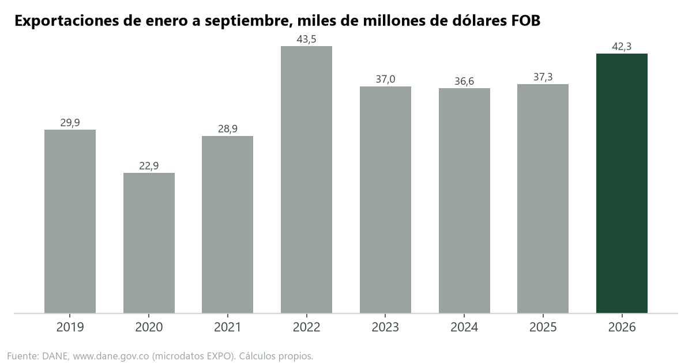
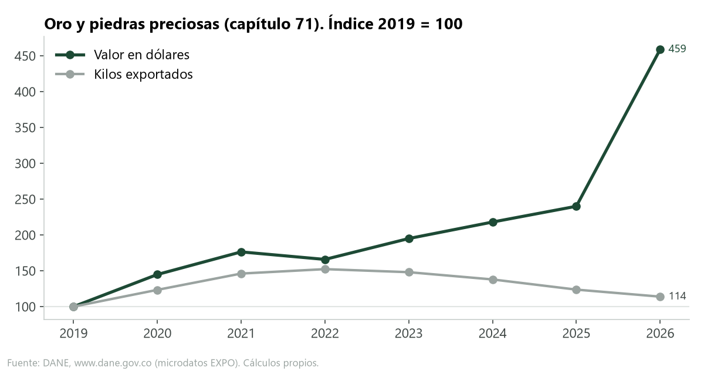
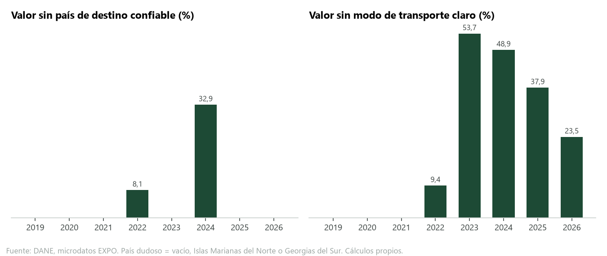
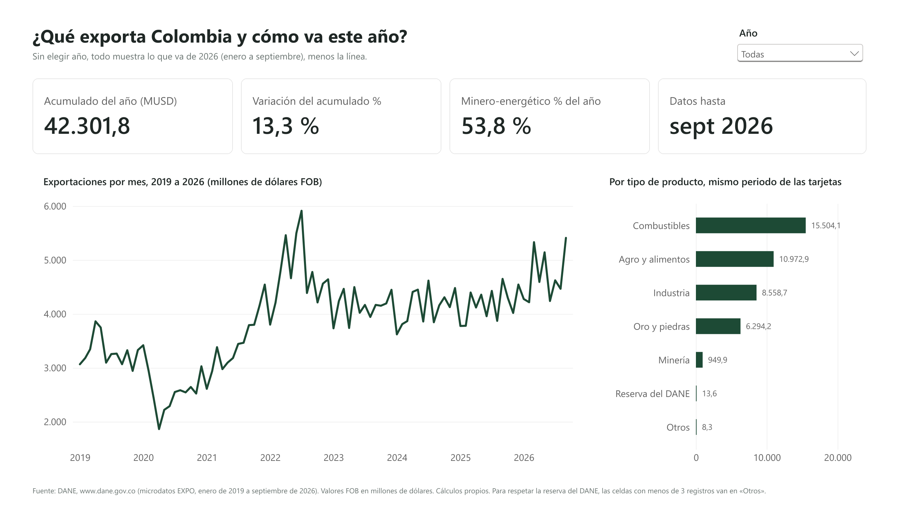
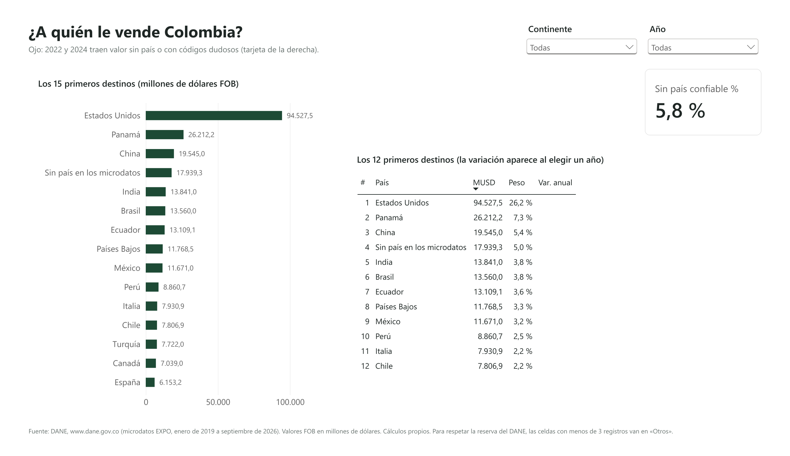
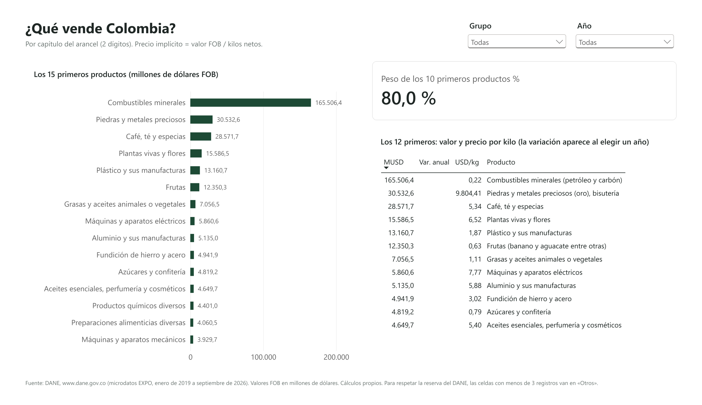
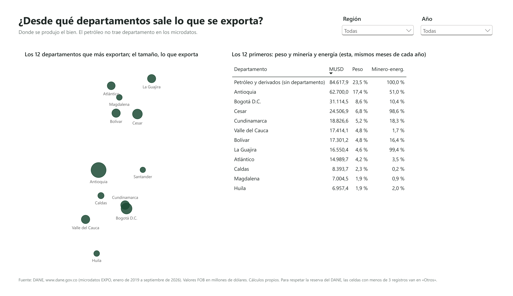
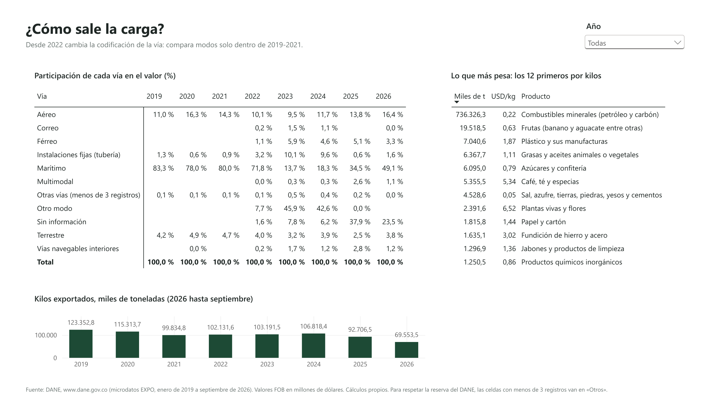
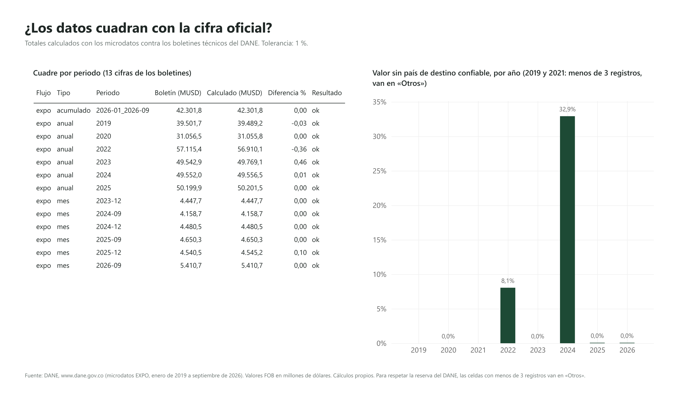
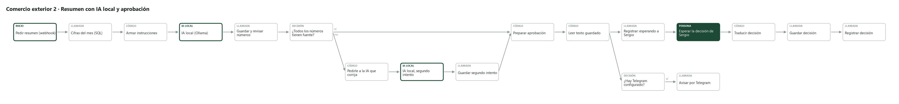

# Colombia's Foreign Trade

[Versión en español](README.md) · 

> **In 30 seconds:** from January to September 2026 Colombia exported **US$42,301.8 million**, 13.3% more than in 2025, and my calculation matches DANE exactly. Gold rose 91.2% because of price, not volume. I also found errors in the microdata that the bulletin does not show: in 2024 a third of the value has no reliable destination country. **SQL** (DuckDB) · **Power BI** (DAX and Power Query) · **n8n** with local AI and human approval · **tests** in GitHub Actions.

What does Colombia export, to whom, from which departments, and how does it change month to month? I answer this using official DANE microdata: 3,706,749 export records from January 2019 to September 2026. I built the data load and quality checks in SQL, the dashboard in Power BI, and two workflows in n8n: one checks if DANE publishes new data, and the other asks a local AI for a monthly summary that I approve before publishing.



## What I found

1. **2026 is on track to be a strong year.** From January to September, Colombia exported US$42,301.8 million FOB, 13.3% more than in the same months of 2025. It is the highest value for this period since 2022 (US$43,492.6 million). My calculation matches the exact figure in the DANE bulletin.

2. **Gold explains most of the increase, driven by price rather than volume.** Of the 13.3 points of export growth, gold contributes 8.0, oil and coal 5.7, and coffee subtracts 1.2. From January to September 2026, gold and precious stones totaled US$6,294.2 million, 91.2% more than in 2025, but with 7.9% fewer kilos. The implicit price per kilo rose 107.7%. Compared to 2019, gold value multiplied by 4.6 while kilos only multiplied by 1.1. That is why Italy jumped to third place among destinations: out of US$2,325.0 million we sold them, US$1,799.0 million was gold.

3. **Coffee is worth more with less coffee.** I count chapter 09 of the tariff (coffee, tea and spices). In 2025, coffee sales grew 77.1% (US$4,315.7 million from January to September). The price per kilo went from US$3.04 in 2019 to US$8.02 in 2026, while volume dropped from 574.4 to 480.8 thousand tons. In 2026, value fell 10.6% because volume sold dropped 14.9%.

4. **We still depend on mining and energy (oil, coal, gold, and other minerals such as nickel), but less than before.** In 2019, they accounted for 60.4% of exported value (January to September). In 2025, they dropped to 46.8%, and in 2026 they returned to 53.8%, pushed by gold. Oil and coal alone went from 55.7% to 36.7%. Agriculture and food went from 18.4% to 26.0%.

5. **The microdata has errors that the bulletin does not show, and you have to find them before drawing conclusions.**
   - In 2024, US$16,313.9 million (32.9% of the year) comes without a destination country or with questionable codes (Northern Mariana Islands and South Georgia, which have almost no inhabitants). Because of this, the United States appears with US$9,513.9 million in the microdata and US$14,336.8 million in the bulletin, ranking second in that year's microdata: the top "destination" is "no country." In 2022, the same thing happens with 8.1% of the value. I do not compare destinations using those two years.
   - The February 2026 .zip file includes the months of August and September again. If you read all files directly, 2026 would total US$52,179.1 million, inflated by 23%.
   - The mode of transport changes its coding starting in 2022: in 2023, 53.7% of the value falls under "other mode" or "no information." Transport modes can only be compared between 2019 and 2021.
   - Some months are comma-separated with a decimal point, and others are semicolon-separated with a decimal comma and a thousands dot. Reading them all the same way multiplies values by a thousand.





## The dashboard

Six pages: overview, destinations, products, departments, logistics, and reconciliation with DANE. It is in [`powerbi/`](powerbi/) as a Power BI file (`comercio_exterior.pbix`), as a text project (`.pbip`, reviewable in git) and as a [PDF](powerbi/comercio_exterior.pdf). The project is generated by `scripts/generar_powerbi.py`. The map on the departments page is a scatter chart with each department's latitude and longitude, so it does not depend on Azure Maps or an account. To respect DANE's statistical confidentiality, the dashboard shows no cell with fewer than 3 records: they go to "Others" (0.5% of the value in destinations, 0.7% in departments, and 0.2% in logistics). That is why it uses three tables, one per page: country and department cannot be crossed, and the tariff chapter is only in logistics (so subtracting one table from another does not reveal one or two shipments either). The dashboard is in Spanish.



| Destinations (2026) | Products (2026) |
|---|---|
|  |  |
| **Departments** | **Logistics** |
|  |  |



## Figures match the source

Every time data is loaded, `sql/04_control_calidad.sql` compares my totals against DANE's technical bulletins. Today, all 13 comparable figures match, with differences between 0.0% and 0.46% (DANE revises figures after publishing the bulletin). The full table, with a link to each bulletin, is in [`datos/agregados/control_vs_boletin.csv`](datos/agregados/control_vs_boletin.csv).

## How it works

```
DANE (microdata, captcha download: I do it manually)
  └─ datos/crudos/*.zip            not uploaded to GitHub
       └─ scripts/pipeline.py      reads only CSVs, no NIT or company name
            └─ DuckDB + sql/       checks, aggregates, and monthly figures
                 ├─ datos/agregados/ and datos/powerbi/   read by Power BI
                 └─ scripts/servidor.py  (port 5688)      used by n8n
n8n
  ├─ workflow 1: every morning checks the DANE page, alerts if there are new files,
  │              loads, validates, and logs the run (does not duplicate if run twice)
  ├─ workflow 2: pulls monthly figures with SQL, local AI (Ollama) writes the summary,
  │              a check verifies every number exists in the data, and I approve,
  │              edit, or reject it in a form. The decision is logged.
  └─ workflow 0: if any workflow fails, logs it and sends an alert
```



- **The AI:** `qwen3.5:9b` running on my PC with Ollama. I compared it with `qwen3.5:4b` using the real figures for September 2026 ([`docs/prueba_modelos.json`](docs/prueba_modelos.json)): both passed the number check 3 out of 3 times, but the 9B model wrote more clearly. Note: the check verifies that every number exists in the data, not that the sentence makes sense. In a test with synthetic data the AI wrote "flowers had no exports" because the value rounded to 0.0. Now those values no longer reach the AI and the check rejects that kind of sentence, but other misreadings are possible: that is why a person has the final say.
- **SQL:** [`sql/`](sql/), 11 numbered and commented files. Includes window functions (year-to-date, moving average, ranking, year-over-year comparison), concentration (Herfindahl index), and price vs. volume.
- **DAX:** [`dax/medidas.md`](dax/medidas.md). **Data dictionary (Spanish):** [`docs/diccionario_datos.md`](docs/diccionario_datos.md).
- **n8n workflows:** [`flujos/`](flujos/), exported as JSON.
- **Tests:** [`tests/`](tests/), using synthetic data that replicates the pitfalls of the real files. They run in GitHub Actions along with a test that spins up n8n, Postgres, and the pipeline with Docker.

## How to run it

You need **Python 3.12 or newer** (the version GitHub Actions and Docker use).

**To try it without downloading anything** (fictional data with the same traps as the real files):

```
python -m venv .venv
.venv\Scripts\activate              # on Windows. On Mac or Linux: source .venv/bin/activate
pip install -r requirements.txt
python -m pytest                     # the tests, with fictional data
python scripts/generar_muestra.py    # builds two fictional .zip files (years 2030 and 2031)
python scripts/pipeline.py todo --muestra
```

**With the real DANE data:**

1. Download the export .zip files from DANE (pages and file sizes are in [`datos/crudos/LEEME_DESCARGAS.md`](datos/crudos/LEEME_DESCARGAS.md)) and place them in `datos/crudos/`. The page has a captcha, so they are downloaded by hand.
2. Load, validate and export: `python scripts/pipeline.py todo`. If it cannot find the .zip files, it says so and exits with an error.
3. n8n without Docker (how I run it, on Windows): `npm install --prefix .n8n-app n8n@2.44.7` once, then double-click [`levantar_n8n.cmd`](levantar_n8n.cmd). Import the workflows with `.n8n-app\node_modules\.bin\n8n import:workflow --separate --input=flujos`.
4. n8n with Docker (any system): copy `.env.example` to `.env`, set a Postgres password, and run `docker compose up -d --build`. Import the workflows with `docker compose exec n8n n8n import:workflow --separate --input=/flujos`. The AI needs Ollama on your computer with the `qwen3.5:9b` model. Telegram alerts are optional (`TELEGRAM_TOKEN` and `TELEGRAM_CHAT_ID` in `.env`).
5. Power BI: open `powerbi/comercio_exterior.pbip` and change the `CarpetaDatos` parameter to the `datos` folder in your local copy.

## Data and license

- **Source: DANE, www.dane.gov.co.** Export Statistics (EXPO), catalogs [472](https://microdatos.dane.gov.co/index.php/catalog/472) (2011-2024) and [859](https://microdatos.dane.gov.co/index.php/catalog/859) (2025-2026). Downloaded on Nov 4, 2026.
- Department coordinates: DANE, DIVIPOLA on [datos.gov.co](https://www.datos.gov.co/d/gdxc-w37w) (CC BY 4.0 license), average of the municipal seats. Subheading names: Colombian Customs Tariff ([Decree 1881 of 2021](https://normograma.dian.gov.co/dian/compilacion/docs/decreto_1881_2021.htm)), summarized.
- DANE's license does not allow republishing the microdata. That is why this repo includes the code and aggregates, never the raw files. There are also no tax IDs (NIT) or company names: the loader does not read those columns.
- The code is mine, under the MIT license.

## What is missing

- Imports (catalogs 473 and 856) to show the trade balance. The schema is already set up; only the files are missing, about 2.1 GB.
- Names for every subheading. Today 35 have a name (at 6 digits), including all that reach the top 20 in any year.

## How to explain it in 2 minutes

I wanted to know what Colombia exports and to whom, using official data rather than headlines. I downloaded DANE's microdata, nearly 3.7 million records since 2019, and built the SQL load with checks that compare every total against the official bulletin. They match.

The first thing I noticed is that the files are not as clean as they look. Number formatting changes from one month to another, one .zip file contains two duplicate months, and in 2024 a third of the value has no reliable destination country. If you do not check for this, you draw wrong conclusions, like thinking we sold much less to the United States in 2024.

With clean data, I found three things. One: 2026 is up 13.3%, largely due to gold, which rose in price rather than volume. Two: coffee is worth much more per kilo than in 2019. Three: reliance on mining and energy dropped, although gold pushed it back up this year.

I also automated it with n8n. One workflow checks every morning if DANE published new data and sends an alert. Another passes the monthly figures to an AI running on my PC, checks that it does not make up any numbers, and lets me approve the summary before publishing it. The idea is for AI to help, while a person has the final say.

## How I built it

Claude (AI) wrote the code under my direction. I defined the question and the rules (no raw data or company information in public, every figure checked against the source, AI does not publish without my approval), downloaded the data, and approve each summary. The step-by-step log, including what was found and fixed in each review, is in [`REVISION.md`](REVISION.md).

