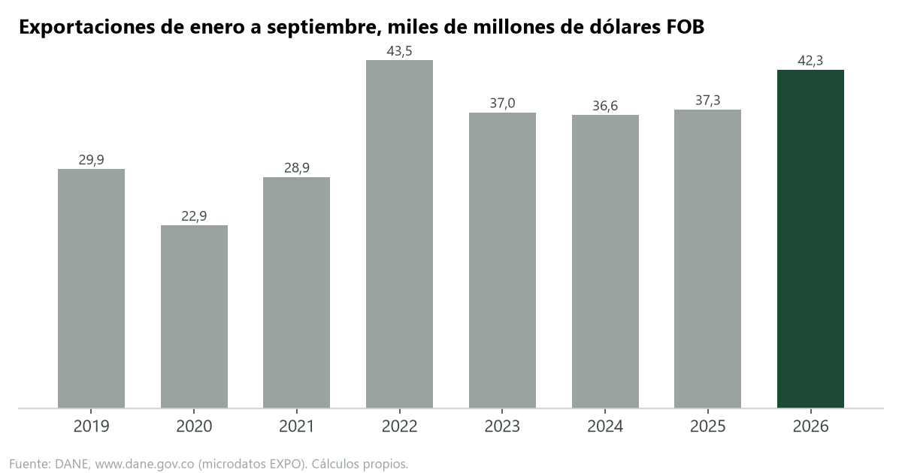
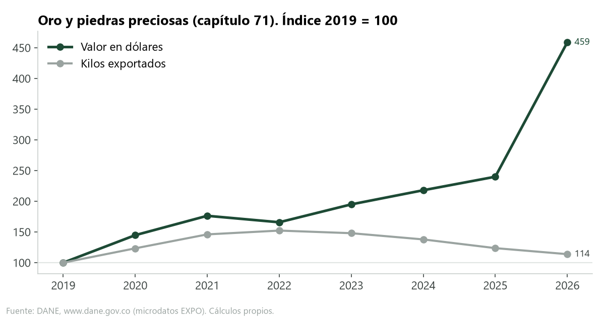
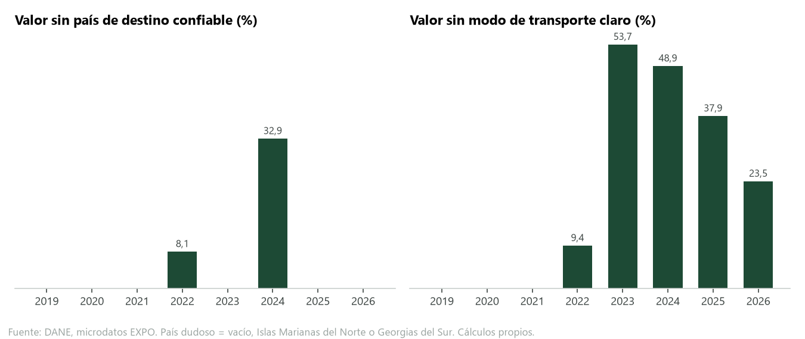
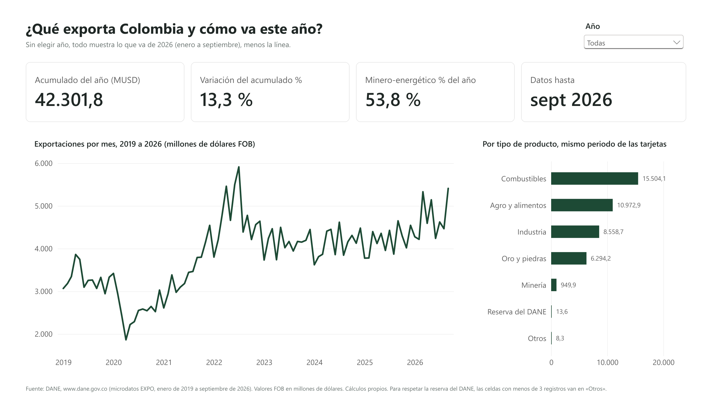
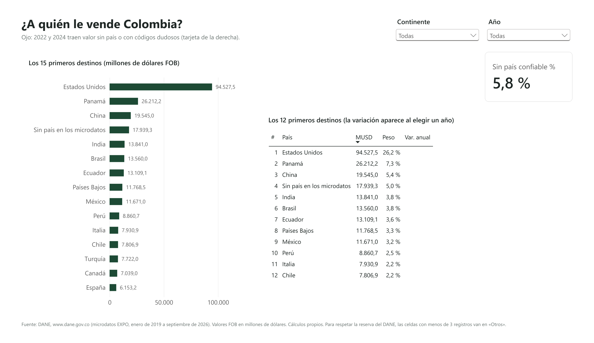
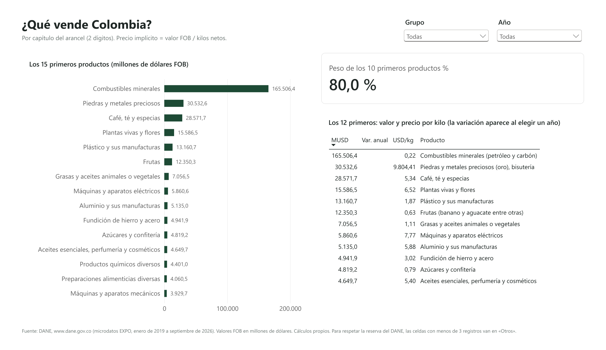
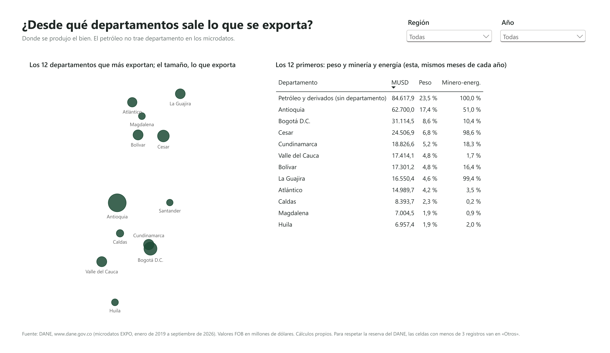
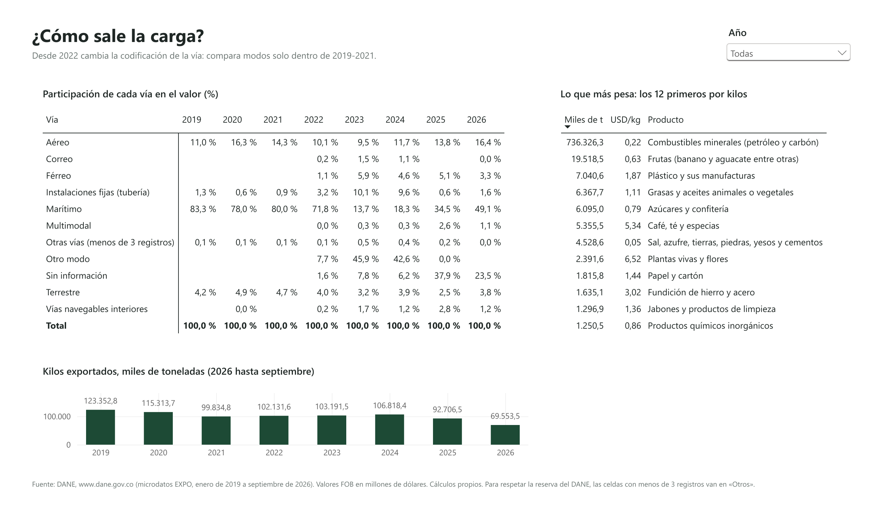
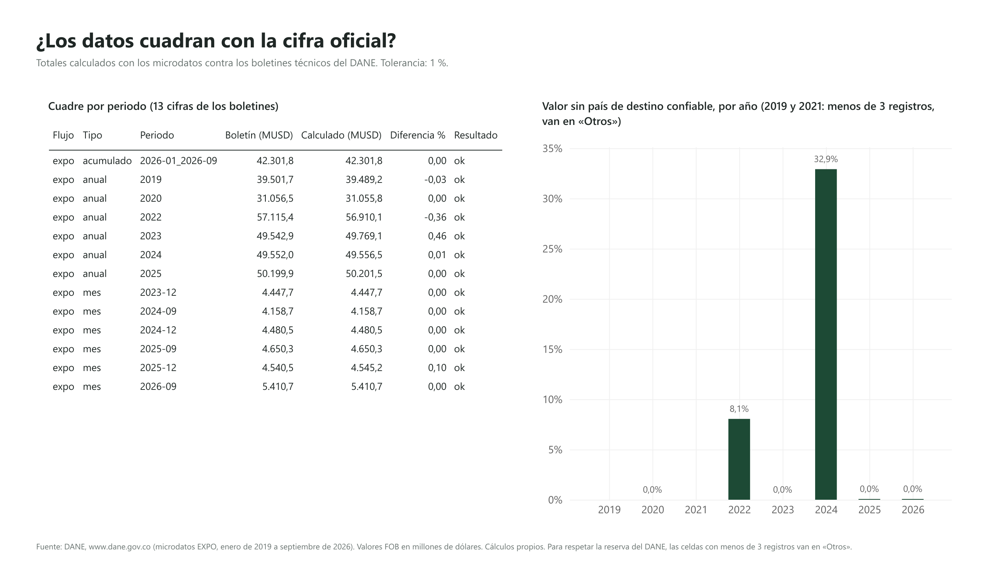
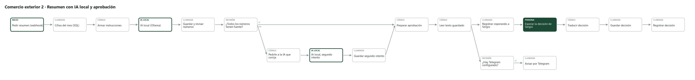

# Comercio exterior de Colombia

[English version](README.en.md) · 

> **En 30 segundos:** de enero a septiembre de 2026 Colombia exportó **US$42.301,8 millones**, 13,3 % más que en 2025, y mi cálculo cuadra exacto con el DANE. El oro subió 91,2 % por precio, no por volumen. Además encontré errores en los microdatos que el boletín no muestra: en 2024 un tercio del valor viene sin un país de destino confiable. **SQL** (DuckDB) · **Power BI** (DAX y Power Query) · **n8n** con IA local y aprobación humana · **pruebas** en GitHub Actions.

¿Qué exporta Colombia, a quién, desde qué departamentos, y cómo cambia mes a mes? Lo respondo con los microdatos oficiales del DANE: 3.706.749 registros de exportación, de enero de 2019 a septiembre de 2026. Hice la carga y los controles en SQL, el tablero en Power BI, y dos flujos en n8n: uno vigila si el DANE publica datos nuevos y otro le pide a una IA local un resumen del mes que yo apruebo antes de publicarlo.



## Qué encontré

1. **2026 va para ser un año fuerte.** De enero a septiembre Colombia exportó US$42.301,8 millones FOB, 13,3 % más que en los mismos meses de 2025. Es el valor más alto para ese periodo desde 2022 (US$43.492,6 millones). Mi cálculo da exactamente la misma cifra del boletín del DANE.

2. **El oro explica la mayor parte de la subida, y es por precio, no por volumen.** De los 13,3 puntos que crecieron las exportaciones, el oro aporta 8,0, el petróleo y el carbón 5,7, y el café resta 1,2. De enero a septiembre de 2026 el oro y las piedras preciosas sumaron US$6.294,2 millones, 91,2 % más que en 2025, pero con 7,9 % menos kilos. El precio implícito por kilo subió 107,7 %. Contra 2019, el valor del oro se multiplicó por 4,6 y los kilos solo por 1,1. Por eso Italia saltó al tercer puesto de destinos: de US$2.325,0 millones que le vendimos, US$1.799,0 millones fueron oro.

3. **El café vale más con menos café.** Cuento el capítulo 09 del arancel (café, té y especias). En 2025 las ventas de café crecieron 77,1 % (US$4.315,7 millones de enero a septiembre). El kilo pasó de US$3,04 en 2019 a US$8,02 en 2026, mientras los kilos bajaron de 574,4 a 480,8 miles de toneladas. En 2026 el valor cayó 10,6 % porque se vendió 14,9 % menos volumen.

4. **Seguimos dependiendo de la minería y la energía (petróleo, carbón, oro y otros minerales como el níquel), pero menos que antes.** En 2019 eran el 60,4 % del valor exportado (enero a septiembre). En 2025 bajaron a 46,8 % y en 2026 volvieron a 53,8 %, empujados por el oro. El petróleo y el carbón solos pasaron de 55,7 % a 36,7 %. Agro y alimentos pasó de 18,4 % a 26,0 %.

5. **Los microdatos tienen errores que el boletín no muestra, y hay que encontrarlos antes de concluir.**
   - En 2024, US$16.313,9 millones (32,9 % del año) vienen sin país de destino o con códigos dudosos (Islas Marianas del Norte y Georgias del Sur, que casi no tienen habitantes). Por eso Estados Unidos aparece con US$9.513,9 millones en los microdatos y con US$14.336,8 millones en el boletín, y en los microdatos de ese año queda segundo: el primer «destino» es «sin país». En 2022 pasa lo mismo con el 8,1 % del valor. No comparo destinos usando esos dos años.
   - El .zip de febrero de 2026 trae metidos otra vez los meses de agosto y septiembre. Si se leen todos los archivos, 2026 quedaría en US$52.179,1 millones, un 23 % inflado.
   - La vía de transporte cambia de codificación desde 2022: en 2023 el 53,7 % del valor queda en «otro modo» o «sin información». Los modos solo se pueden comparar entre 2019 y 2021.
   - Unos meses vienen separados por coma con punto decimal y otros por punto y coma con coma decimal y punto de miles. Leer todos igual multiplica valores por mil.





## El tablero

Seis páginas: resumen, destinos, productos, departamentos, logística y cuadre con el DANE. Está en [`powerbi/`](powerbi/) como archivo de Power BI (`comercio_exterior.pbix`), como proyecto en texto (`.pbip`, que se puede revisar en git) y como [PDF](powerbi/comercio_exterior.pdf). El proyecto lo arma `scripts/generar_powerbi.py`. El mapa de la página de departamentos es un gráfico de dispersión con la latitud y la longitud de cada departamento, para no depender de Azure Maps ni de una cuenta. Para respetar la reserva del DANE, el tablero no muestra celdas con menos de 3 registros: van a «Otros» (0,5 % del valor en destinos, 0,7 % en departamentos y 0,2 % en logística). Por eso usa tres tablas, una por página: no se pueden cruzar país y departamento, y el capítulo solo está en logística (así, restar una tabla de otra tampoco deja ver uno o dos envíos).



| Destinos (2026) | Productos (2026) |
|---|---|
|  |  |
| **Departamentos** | **Logística** |
|  |  |



## Las cifras cuadran con la fuente

Cada vez que se cargan datos, `sql/04_control_calidad.sql` compara mis totales con los boletines técnicos del DANE. Hoy cuadran las 13 cifras que se pueden comparar, con diferencias entre 0,0 % y 0,46 % (el DANE revisa cifras después del boletín). La tabla completa, con el enlace a cada boletín, está en [`datos/agregados/control_vs_boletin.csv`](datos/agregados/control_vs_boletin.csv).

## Cómo funciona

```
DANE (microdatos, descarga con captcha: la hago a mano)
  └─ datos/crudos/*.zip            no se suben a GitHub
       └─ scripts/pipeline.py      lee solo los CSV, sin NIT ni razón social
            └─ DuckDB + sql/       controles, agregados y cifras del mes
                 ├─ datos/agregados/ y datos/powerbi/   lo que lee Power BI
                 └─ scripts/servidor.py  (puerto 5688)  lo que usa n8n
n8n
  ├─ flujo 1: cada mañana revisa la página del DANE, avisa si hay archivos nuevos,
  │           carga, valida y registra la corrida (no duplica si se corre dos veces)
  ├─ flujo 2: saca las cifras del mes con SQL, la IA local (Ollama) escribe el resumen,
  │           un control revisa que cada número exista en los datos y yo apruebo,
  │           corrijo o rechazo en un formulario. Queda registrada la decisión.
  └─ flujo 0: si cualquier flujo falla, lo registra y avisa
```



- **La IA:** `qwen3.5:9b` corriendo en mi PC con Ollama. La comparé con `qwen3.5:4b` usando las cifras reales de septiembre de 2026 ([`docs/prueba_modelos.json`](docs/prueba_modelos.json)): los dos pasaron el control de números 3 de 3 veces, pero el de 9B escribió más claro. Ojo: el control revisa que cada número exista en los datos, no que la frase tenga sentido. En una prueba con datos ficticios la IA escribió «las flores no tuvieron exportaciones» porque el valor redondeaba a 0,0. Ahora esos valores no le llegan a la IA y el control rechaza esa clase de frase, pero puede haber otras lecturas equivocadas: por eso la última palabra la tiene una persona.
- **SQL:** [`sql/`](sql/), 11 archivos numerados y comentados. Hay funciones de ventana (acumulado del año, promedio móvil, ranking, comparación contra el año anterior), concentración (índice Herfindahl) y precio contra volumen.
- **DAX:** [`dax/medidas.md`](dax/medidas.md). **Diccionario de datos:** [`docs/diccionario_datos.md`](docs/diccionario_datos.md).
- **Flujos de n8n:** [`flujos/`](flujos/), exportados en JSON.
- **Pruebas:** [`tests/`](tests/), con datos ficticios que copian las trampas de los archivos reales. Corren en GitHub Actions junto con una prueba que levanta n8n, Postgres y el pipeline con Docker.

## Cómo correrlo

Necesitas **Python 3.12 o más nuevo** (es el que usan GitHub Actions y Docker).

**Para probarlo sin descargar nada** (datos ficticios con las mismas trampas de los archivos reales):

```
python -m venv .venv
.venv\Scripts\activate              # en Windows. En Mac o Linux: source .venv/bin/activate
pip install -r requirements.txt
python -m pytest                     # las pruebas, con datos ficticios
python scripts/generar_muestra.py    # arma dos .zip ficticios (años 2030 y 2031)
python scripts/pipeline.py todo --muestra
```

**Con los datos reales del DANE:**

1. Descarga los .zip de exportaciones del DANE (las páginas y los tamaños están en [`datos/crudos/LEEME_DESCARGAS.md`](datos/crudos/LEEME_DESCARGAS.md)) y déjalos en `datos/crudos/`. La página tiene captcha, así que se bajan a mano.
2. Carga, valida y exporta: `python scripts/pipeline.py todo`. Si no encuentra los .zip, te lo dice y sale con error.
3. n8n sin Docker (como lo corro yo, en Windows): `npm install --prefix .n8n-app n8n@2.44.7` una vez, y después doble clic en [`levantar_n8n.cmd`](levantar_n8n.cmd). Importa los flujos con `.n8n-app\node_modules\.bin\n8n import:workflow --separate --input=flujos`.
4. n8n con Docker (cualquier sistema): copia `.env.example` como `.env`, pon una clave de Postgres y corre `docker compose up -d --build`. Importa los flujos con `docker compose exec n8n n8n import:workflow --separate --input=/flujos`. Para la IA necesitas Ollama en tu PC con el modelo `qwen3.5:9b`. Los avisos por Telegram son opcionales (`TELEGRAM_TOKEN` y `TELEGRAM_CHAT_ID` en `.env`).
5. Power BI: abre `powerbi/comercio_exterior.pbip` y cambia el parámetro `CarpetaDatos` a la carpeta `datos` de tu copia.

## Datos y licencia

- **Fuente: DANE, www.dane.gov.co.** Estadísticas de Exportaciones (EXPO), catálogos [472](https://microdatos.dane.gov.co/index.php/catalog/472) (2011-2024) y [859](https://microdatos.dane.gov.co/index.php/catalog/859) (2025-2026). Descargados el 4-nov-2026.
- Coordenadas de los departamentos: DANE, DIVIPOLA en [datos.gov.co](https://www.datos.gov.co/d/gdxc-w37w) (licencia CC BY 4.0), promedio de las cabeceras municipales. Nombres de las subpartidas: Arancel de Aduanas de Colombia ([Decreto 1881 de 2021](https://normograma.dian.gov.co/dian/compilacion/docs/decreto_1881_2021.htm)), resumidos.
- La licencia del DANE no permite volver a publicar los microdatos. Por eso el repo trae el código y los agregados, nunca los archivos crudos. Tampoco hay NIT ni nombres de empresas: el cargador no lee esas columnas.
- El código es mío, con licencia MIT.

## Qué falta

- Importaciones (catálogos 473 y 856) para ver la balanza comercial. Ya está preparado en el esquema; faltan los archivos, unos 2,1 GB.
- Nombres de todas las subpartidas. Hoy tienen nombre 35 (a 6 dígitos), entre ellas todas las que llegan a las 20 primeras de algún año.

## Cómo explicarlo en 2 minutos

Quería saber qué exporta Colombia y a quién, con datos oficiales y no con titulares. Bajé los microdatos del DANE, casi 3,7 millones de registros desde 2019, y armé la carga en SQL con controles que comparan cada total con el boletín oficial. Cuadran.

Lo primero: me di cuenta de que los archivos no son tan limpios como parecen. El formato de los números cambia de un mes a otro, un .zip trae dos meses repetidos y en 2024 un tercio del valor viene sin un país de destino confiable. Si no lo revisas, sacas conclusiones equivocadas, como que a Estados Unidos le vendimos mucho menos en 2024.

Con los datos limpios encontré tres cosas. Uno: 2026 va 13,3 % arriba, buena parte por el oro, que subió por precio y no por volumen. Dos: el café vale mucho más por kilo que en 2019. Tres: la dependencia de la minería y la energía bajó, aunque el oro la volvió a subir este año.

Además lo automaticé con n8n. Un flujo revisa cada mañana si el DANE publicó algo nuevo y avisa. Otro le pasa las cifras del mes a una IA que corre en mi PC, revisa que no invente ningún número y me deja aprobar el resumen antes de publicarlo. La idea es que la IA ayude, pero que la última palabra la tenga una persona.

## Cómo lo hice

El código lo escribió Claude (IA) con mi dirección. Yo definí la pregunta y las reglas (nada de datos crudos ni de empresas en público, cada cifra contra la fuente, la IA no publica sin mi aprobación), descargué los datos y apruebo cada resumen. El paso a paso, con lo que se encontró y se arregló en cada revisión, está en [`REVISION.md`](REVISION.md).
